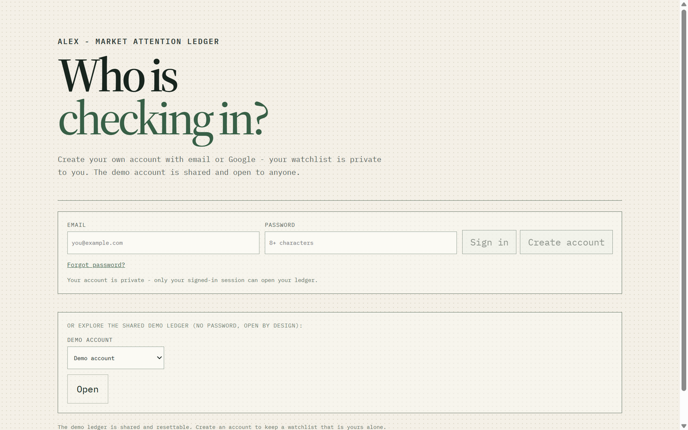
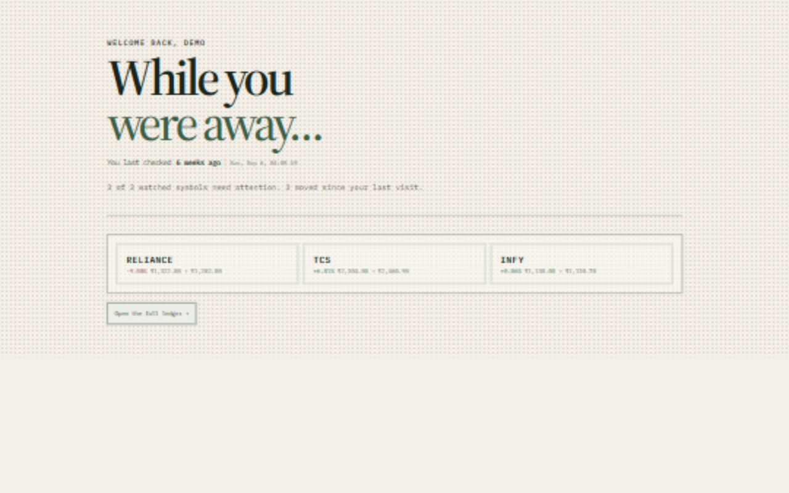
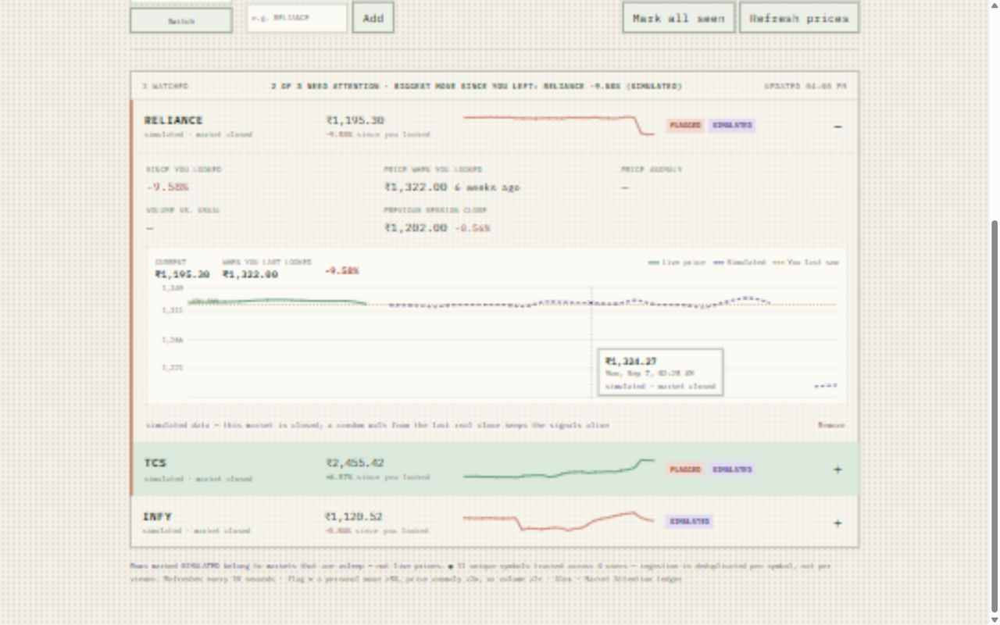

# Alex Watchlist

An attention-first market watchlist built for Groww Code 2026. It answers **what changed while I was away?** rather than presenting an undifferentiated price list.

**Live demo**: [alex-market-attention-ledger.vercel.app](https://alex-market-attention-ledger.vercel.app) · API: [alex-watchlist-api.onrender.com/docs](https://alex-watchlist-api.onrender.com/docs)

## Screenshots

**Login** — create an account with email or Google, reset a password with a Gmail OTP, or open the shared demo account from the dropdown; state persists per user across sessions and devices.



**"While you were away" summary** — the landing moment: what moved since your last visit, with an honest note when markets are closed.



**The ledger** — expandable rows with the three explainable signals, price history chart, and full source provenance.



## What it does

- **Two live sources, no synthetic generator**: Yahoo Finance's keyless chart endpoint is primary; Twelve Data (`/quote`, free tier, throttled to ~800 requests/day) cross-checks when an API key is set. Dual-listed tickers resolve NSE-first (INFY is Infosys Ltd, not the NYSE ADR), and bare NSE tickers are retried with `.NS` automatically.
- **Everything is displayed in INR.** Quotes are stored in their native currency and converted once at the API boundary using a cached live USD/INR rate (`INR=X`, refreshed every 5 minutes). NSE quotes are never double-converted.
- **Conflict handling is real and visible.** When both sources respond, both are converted to INR first, then compared. A spread beyond 0.5% is a real conflict: the fresher timestamp wins, and the expanded row shows both disagreeing values and which source was used. A lone source is marked single-sourced, not silently agreed-upon.
- **Three independent, explainable signals** per row: change since *you* last looked, price anomaly z-score, and volume versus its rolling average. A row is flagged when any signal crosses its named threshold — never via a blended score.
- **A "While you were away" summary screen** on login: flagged count, top movers since your last visit, and a market-asleep note.
- **Closed markets are handled honestly.** A symbol whose provider timestamp stops advancing is asleep (night, weekend, holiday — no exchange calendar needed). Its row keeps updating from a clearly-labelled `SIMULATED` random walk that mean-reverts toward the last real close, so the signals stay demoable without faking live data: simulated rows never become seen-baselines, never enter real signal history, never participate in conflict resolution, and get their own small retention window so they can never evict real history.
- **History is real from minute one.** A newly added symbol backfills ~26 intraday bars from Yahoo, and unchanged quotes are never re-stored — so z-scores and volume ratios have genuine variance instead of 15-second duplicates.
- **Honest freshness.** Feed staleness ("we haven't reached this symbol in 45s") is separate from market closure, and the UI shows data age, source, and resolved conflicts on every row.
- **A footer stat** ("N unique symbols tracked across M users") is the demoable proof that ingestion is deduplicated per symbol, not per user-per-symbol — the actual scaling lever.

## Run it

**Hosted (no setup):** open [alex-market-attention-ledger.vercel.app](https://alex-market-attention-ledger.vercel.app) and create an account with email or Google, or open one of the shared demo ledgers. Registered watchlists are private to the signed-in account; demo ledgers are shared and resettable. The first load after inactivity may take ~30 seconds (free-tier server waking up). If markets are closed, rows are honestly labelled `SIMULATED` — prices, personal deltas, and charts still work; during market hours you'll see live prices. The API and its docs live at [alex-watchlist-api.onrender.com/docs](https://alex-watchlist-api.onrender.com/docs).

**Locally:**

```powershell
# backend (Python 3.11+)
cd backend
python -m venv .venv
.\.venv\Scripts\pip install -r requirements.txt
.\.venv\Scripts\python -m uvicorn app.main:app --reload
```

```powershell
# frontend (Node 18+)
cd frontend
npm install
npm run dev
```

Visit `http://localhost:5173`, pick an account, and add tickers — NSE names (`RELIANCE`, `TCS`, `M&M`), US names (`AAPL`), and spaced input (`hdfc bank` → `HDFCBANK`) all work.

Optional secondary source (US symbols get dual-source conflict checking; Twelve Data's free plan does not cover NSE):

```powershell
$env:TWELVE_DATA_API_KEY="your-key"
.\.venv\Scripts\python -m uvicorn app.main:app --reload
```

## Deploy

- **Backend**: `render.yaml` deploys the API. On Render's free tier it sleeps after ~15 minutes without traffic (the background poller only runs while awake — expect a ~30s cold start), SQLite is ephemeral, and outbound SMTP is blocked. Set `TWELVE_DATA_API_KEY`, `ALLOWED_ORIGINS` (the frontend URL, comma-separated), `GOOGLE_CLIENT_ID`, `GMAIL_RELAY_URL`, and `GMAIL_RELAY_SECRET` in the dashboard. `AUTH_SECRET` is generated once by Render and kept, so redeploys do not sign everyone out.
- **Frontend**: Vercel/Netlify, root directory `frontend/`, with `VITE_API_BASE` set to the backend URL at build time (see `frontend/.env.example`). `VITE_GOOGLE_CLIENT_ID` is optional; the backend normally supplies the ID through `/auth/config`.

**Free-tier limits.** There is no persistent disk and no outbound SMTP on Render Free. SQLite (accounts, watchlists, seen state) therefore resets on every redeploy or restart, and reset codes must travel over HTTPS. For durable data at zero cost, move the database to a free external Postgres (Neon/Supabase) — that is a code change — or accept the reset.

## Password reset

Reset uses a 6-digit OTP, not a link. `POST /auth/forgot-password` always returns 200, whether or not the address exists. `POST /auth/reset-password` consumes the code once; codes expire after 10 minutes and allow five attempts. A successful reset bumps `users.token_version`, so every existing session for that account is revoked immediately.

Email is sent from Gmail without SMTP: deploy [`docs/gmail-relay.gs`](docs/gmail-relay.gs) as a free Apps Script web app (Execute as: Me; Who has access: Anyone), then set `GMAIL_RELAY_URL` to its `/exec` URL and `GMAIL_RELAY_SECRET` to the same shared secret used in the script. The backend POSTs over HTTPS, which Render Free allows; a consumer Gmail account can send about 100 recipients per day. Without relay configuration the code is printed to the server log for local development.

## Verification

```powershell
cd backend
.\.venv\Scripts\python -m pytest tests -q

cd ..\frontend
npm run build
```

Tests mock both providers at the boundary (no network) and include regression tests for the failure modes actually encountered while building: a listing change that makes fresh rows carry older provider timestamps, simulated rows evicting real history from retention, a closed-market walk drifting from its anchor, and dual-listed ticker resolution.

## Design decisions and trade-offs

**Polling, not streaming.** A 15-second backend poller and 10-second UI refresh are predictable and debuggable; the provider interface isolates ingestion so WebSockets can replace polling without changing the API or UI. Symbols are deduplicated across users before ingestion.

**Storing less, more honestly.** Snapshots are persisted only when the market event changes; feed freshness lives in `symbols.last_polled_at`, so a stable market is never mistaken for a broken feed.

**Real accounts, minimal surface.** Registration and email/password sign-in use scrypt hashes with per-user salts; sessions are HMAC-signed 30-day tokens carrying the immutable `users.id` and a `token_version`, so renaming cannot re-point a session and a password reset revokes every older token. Repeated failed sign-ins are throttled per IP + email (8 failures / 15 minutes). Google Sign-In verifies the ID token audience and requires a verified email before issuing a session. One passwordless demo account remains, opened from a dropdown; it is still token-authenticated. Tokens live in `localStorage` (readable by XSS) — an httpOnly cookie is the next hardening step. Email verification and distributed rate limiting remain out of scope.

**No AI feature.** Every signal is deterministic and auditable. The UI shows the exact threshold that caused a flag, avoiding opaque or investment-advice-like recommendations.

**Scaling story.** Single-process SQLite with WAL is the honest choice for a demo; the next steps are named, not hidden — Postgres for multi-writer safety, a dedicated ingestion worker, and provider failover beyond two sources.
